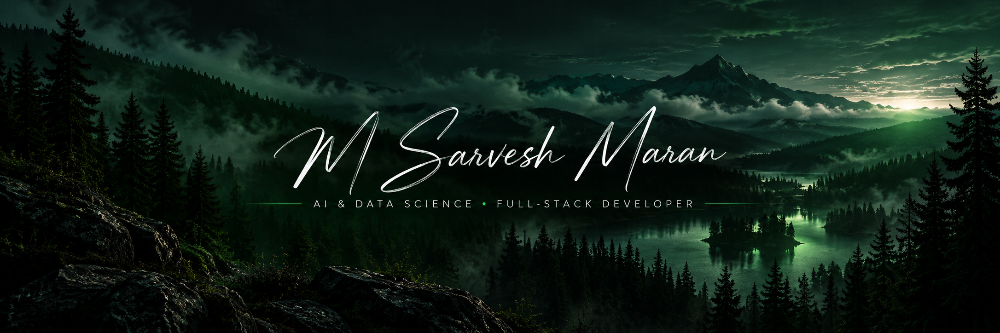

<!-- PROFILE BANNER -->

 

---

<h1 align="center">
  Hi there 👋, &lt; devs /&gt;
</h1>

<h3 align="center">
  AI & Data Science Student · Full-Stack Developer · AI Builder 🚀
</h3>

  I'm <b>M Sarvesh Maran</b>, a B.Tech Artificial Intelligence and Data Science student
  who enjoys turning ideas into practical digital products.
  I work on AI-powered systems, computer vision, web applications, and mobile projects.

  🤖 Artificial Intelligence &nbsp; · &nbsp;
  💻 Full-Stack Development &nbsp; · &nbsp;
  📱 App Development &nbsp; · &nbsp;
  ⚡ Building Real Projects

---

<h2 align="center">🛠️ Tech Stack</h2>

  <b>Languages</b>
    
  

  <b>Web Development</b>
    
  

  <b>AI, Computer Vision & Databases</b>
    
  

  <b>Tools & App Development</b>
    
  

---

<h2 align="center">🚀 Featured Projects</h2>

<table>
<tr>
<td width="50%" valign="top">

<h3 align="center">🤖 AI Exam Surveillance</h3>

Computer vision system for exam monitoring, suspicious-activity detection, attendance tracking, and evidence capture.

Python · OpenCV · YOLO · PyTorch · SQLite

<a href="https://github.com/sarveshmsm15">
View repositories →
</a>

</td>
<td width="50%" valign="top">

<h3 align="center">🌍 Voluntess</h3>

Volunteer and NGO platform with event check-ins, service-hour verification, and certificates.

Next.js · TypeScript · Node.js · MongoDB

<a href="https://github.com/sarveshmsm15">
View repositories →
</a>

</td>
</tr>
<tr>
<td width="50%" valign="top">

<h3 align="center">🅿️ ZONR</h3>

Parking application concept focused on a premium user interface and a modern parking experience.

UI/UX · App Development

</td>
<td width="50%" valign="top">

<h3 align="center">⚡ FONSI</h3>

Productivity and reminder application concept designed to help users organize everyday tasks.

Product Design · Application Development

</td>
</tr>
<tr>
<td colspan="2" align="center">

<h3>📱 MediScan</h3>

Medical application project using Flutter and SQLite.

</td>
</tr>
</table>

---

<h2 align="center">📊 GitHub Statistics</h2>

<table>
<tr>
<td>

</td>
<td>

</td>
</tr>
</table>

---

<h2 align="center">🌐 Connect With Me</h2>

  <i>Learning. Building. Experimenting. Improving.</i>
   
  <b>With ❤️ from India 🇮🇳</b>

